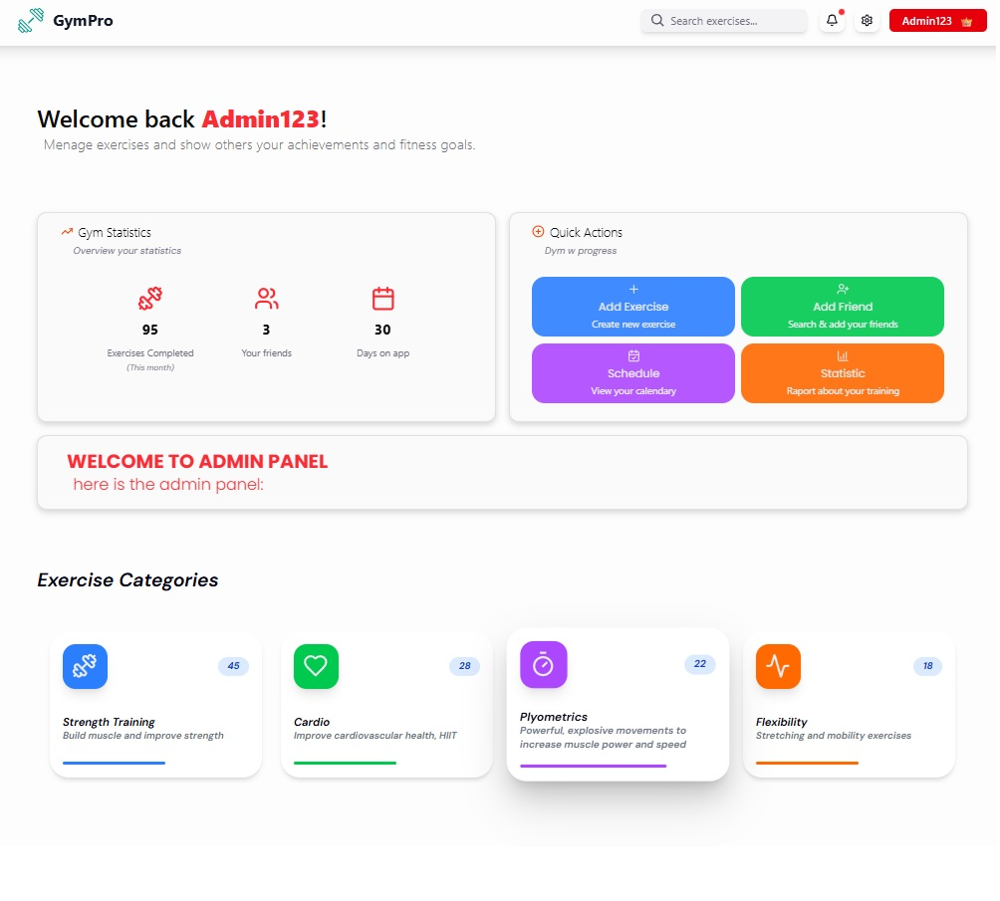
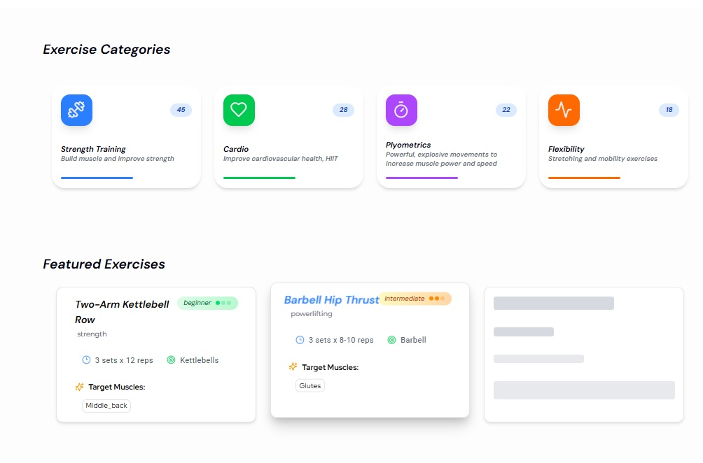
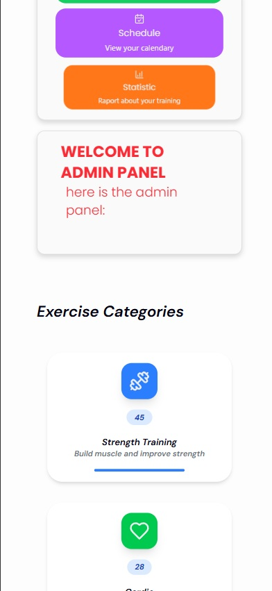
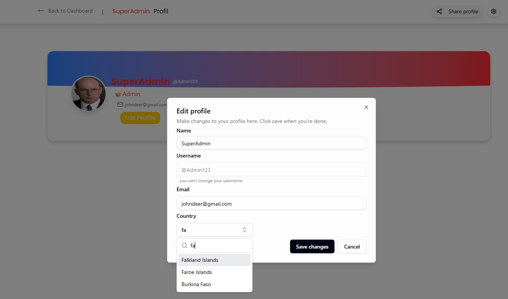

# 🏋️‍♂️ Gym Worker Exercise

### O STRONIE
Strona również nie jest *skończona*. Brakuje jej kilku funkcji.
Baza danych na tej stronie jest lokalna - w folderze /storage znajdują się pliki które symulują działanie bazy danych.
Strona korzysta z API chyba ninja zeby generowac featured exercise. :D
To co jest w tym opisie na dole jest już w większości stworzone, ale brakuje kilku rzeczy np. (Tworzenie całego planu i dodawanie nowych ćwiczeń, Zapisywanie planów treningowych)

## ⬇️ Opis wygenerowany w AI 🤯 ⬇️


### 🎯 Goal
Help gym workers and fitness enthusiasts plan, track, and manage their exercises efficiently!
And track progress of your friends too! 🪩🥳
---


### 🚀 MVP (Minimum Viable Product)
- Basic exercise logging and tracking 📒
- Adding Exercises and Track the schedule of it 📶
- User Profil with possiblity of editing it 🖊️
- Simple, user-friendly interface 😃
- User panel with statistics
- Responsive website app 🛜
---

### ✨ Features
- 📂 local Database profiles
- 📝 Checking the schedule of the user
- 💌 Sending Friends requests
- 📊 Track progress over time
- 🏃 Add multiple types of exercises
- ⏱️ Schedule workouts (if supported in app)

---

# Features to "finish" the project:
    ✅ - Share Profile button -> copy link to github repository. 
    ✅ - Change User Profile Pictures (Admin, User)
    ✅- "Add a Friend" system, where you can send friend request to users.
    ✅- on /user menu with buttons showing (achievements, friends, Workouts Exercise History)
    ✅- Make for User schedule with days that you have already trained. (in /user 3rd tab)
    ✅ - Make Quick Actions, actually working

    - Make working Add Training Plan (localstorage the data - exercise,name, sets,reps,weight)
    - Featured Exercise copy data and push into a new Add Training plan already done exercise
    - Create Footer with links to social media, and GitHub repository.
    - add "Admin" an Admin panel with options to add users, delete users, edit users, etc.
    - Make whole website full responsive


----------------------

=======
### 📸 Screenshots





---

### 🖥️ Technologies
- Vite
- TypeScript
- React
- Tailwindcss

---

### 🤝 Contributing
- PRs and suggestions welcome! 🎉
- Please open an issue for major changes.
- If you are interested into collaboration on any of
  smth of this kind, contact me. 🤝
---


## 🧑‍💻 Installation

1. **Clone the repository**
  ```
  npm clone https://github.com/Marmo77/gym-worker-exercise.git
  cd gym-worker-exercise
  ```
2. Install required
  ```
  npm install
  ```
3. **Run the app!**
  ```
  npm run dev
  ```

---
